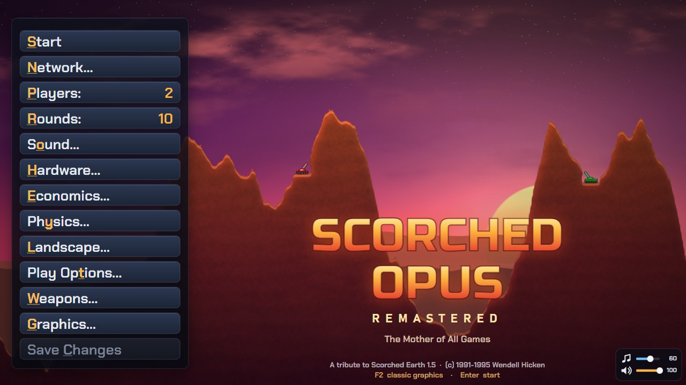
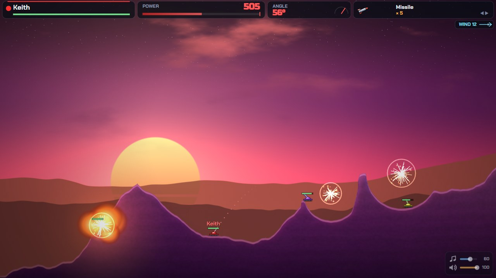
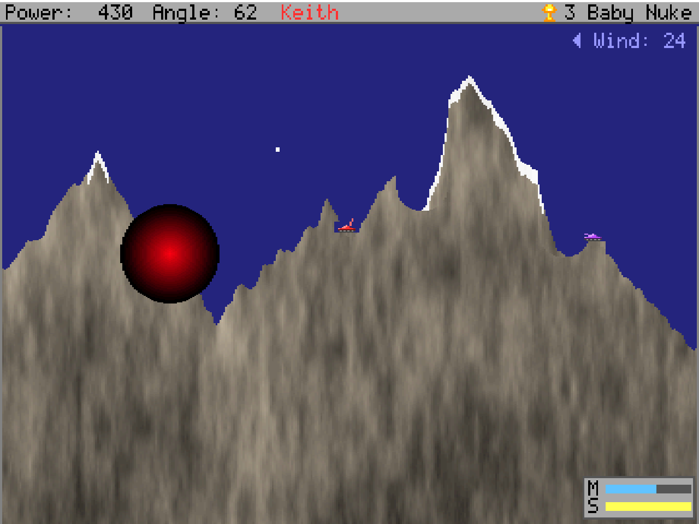
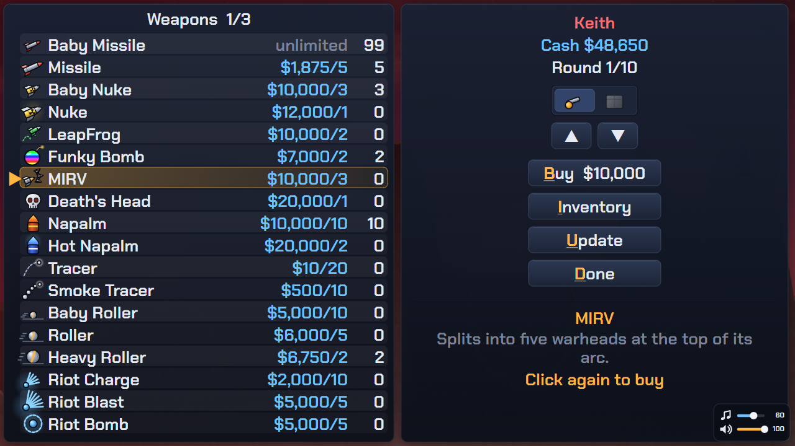
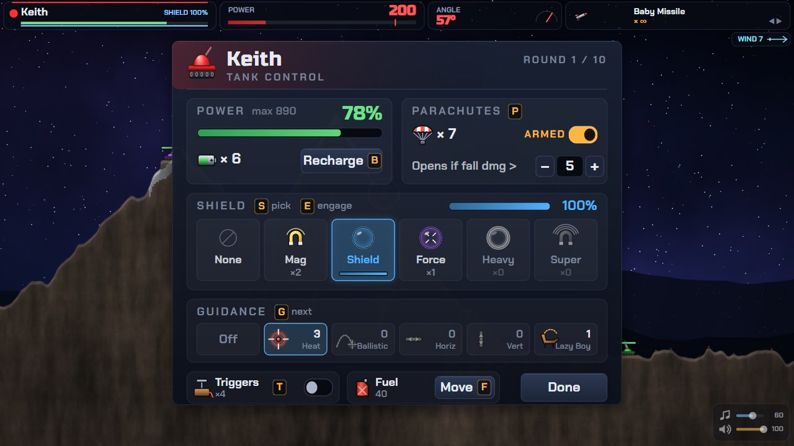
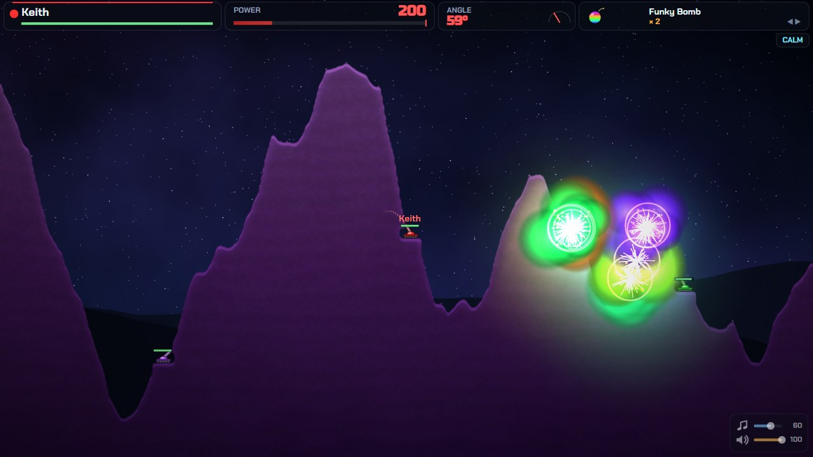
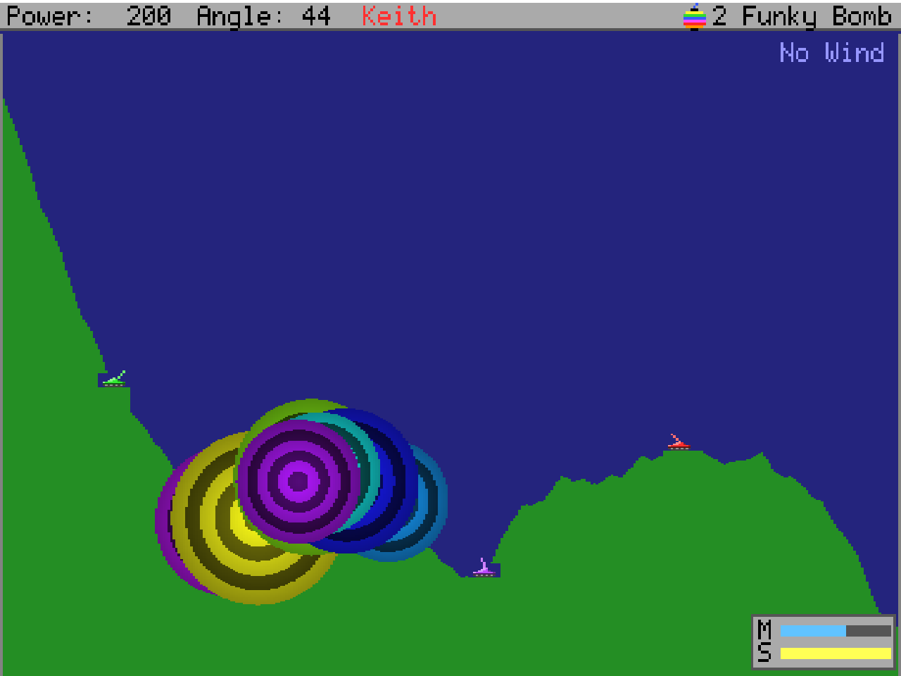

# Scorched Opus Remastered



The **Remastered** edition of Scorched Opus, a browser remake of **Scorched Earth 1.5**
("The Mother of All Games", Wendell Hicken, 1991–1995). The rules are the same: the 33 original
weapons and 15 accessories, the computer opponents, every option from the original menus, and
online play. What's new is modern graphics and sound, plus a few new features.

**F2 switches between the Remastered look and the original VGA look at any time**, even in
the middle of a battle.

**Play it now:** https://keithclemmons.github.io/ScorchedOpus/ (free, online play peer to
peer), or download [`dist/scorched-opus.html`](dist/scorched-opus.html) and open it in a
browser. For regular online games, host your own copy (free on Cloudflare, or any Node host);
see [Playing online](#playing-online).

No libraries are used, and no build step is required.

This is an unofficial fan tribute. It is not affiliated with or endorsed by Wendell Hicken,
and it contains none of the original game's code or files.

<table>
  <tr>
    <td width="50%"></td>
    <td width="50%"></td>
  </tr>
  <tr>
    <td align="center"><b>Remastered</b></td>
    <td align="center"><b>Classic look (press F2)</b></td>
  </tr>
  <tr>
    <td width="50%"></td>
    <td width="50%"></td>
  </tr>
  <tr>
    <td align="center"><b>The shop</b></td>
    <td align="center"><b>Tank Control panel</b></td>
  </tr>
  <tr>
    <td width="50%"></td>
    <td width="50%"></td>
  </tr>
  <tr>
    <td align="center"><b>Funky Bomb volley</b></td>
    <td align="center"><b>Funky Bomb volley, classic look</b></td>
  </tr>
</table>

## What's new in Remastered

**Graphics**
- The battlefield is drawn at your screen's full resolution. Terrain is smooth and anti-aliased,
  with lighting, texture, sunlit edges and burn marks.
- Explosions, napalm and lasers light up the ground around them.
- Skies are animated: clouds drift with the actual wind, stars twinkle, storms bring rain, and
  the sunset sun sits low behind distant ridges.
- Tanks are vector drawings, with shield bubbles, parachutes and glowing projectile trails.
- Explosions are particle effects with smoke, sparks, debris, shockwaves and screen shake.
- A new interface covers the HUD (power and angle gauges, a weapon card, a wind indicator),
  the menus, the shop, the lobby and a live title screen.

**Play**
- **Aim guide:** a dotted preview of the start of your shot. The Full setting shows the whole
  path, wind included, while Off plays the original way.
- **Drag to aim:** click and drag on the battlefield to point the turret. The drag distance
  sets the power.
- **Touch controls** for phones and tablets: angle, power, weapon, tank panel and a big FIRE
  button. They appear by themselves on touch screens, and on phones held upright the HUD moves
  above the battlefield. Tapping a text field (a name, a room code, chat) opens the phone's
  keyboard.
- **Damage numbers, health bars and a kill feed.** Badly damaged tanks smoke, and the finishing
  blow of a round plays in slow motion (Graphics > Slow Motion Finish).
- **Shop descriptions:** the shop explains the highlighted item, with blast size and damage for
  weapons.
- **End-of-game awards:** Demolition Expert, Grim Reaper, Sharpshooter, Heavy Hitter, Long Shot,
  Survivor, Big Spender and Friendly Fire.
- **Online chat:** press Y in a network game. Messages show in a log and as speech bubbles over
  your tank.
- **Remastered sound:** layered synthesized effects with reverb, stereo placement by where things
  happen. Explosions are computed sample by sample. Sound > Explosions picks FILM, a deep blast
  with rumble and debris crackle, or ARCADE, the 8-bit noise-channel kind, and plays each as you
  pick it. Sound > Wind Sound adds wind that follows the battlefield's wind, and Sound > Sound
  Style switches back to the PC speaker.
- **Battlefields that fit the screen:** Graphics Mode `FIT SCREEN` (the default on a first
  visit) makes the battlefield as wide as the window, at 360x480's height and pixel shape, so
  its edges are the screen's edges. In a network game everyone plays the host's exact size.
  `480x480 WIDE` and `854x480 WIDE` are fixed 16:9 sizes. In the fixed sizes, anything beyond
  the battlefield's sides is scenery, and a shell that comes down there is simply gone.
- **Power Limit** (Play Options): in the original, damage cuts your maximum power to 10 per
  point of energy left, so a tank at 27% health can't fire above 270. `HALF` (the default here)
  halves the penalty, so the same tank still gets 635. `ORIGINAL` keeps the 1.5 rule and `OFF`
  removes it.
- **Sky Gates** (Landscape > Sky Gates: how many, 0 to 5): glowing frames hang in the air
  between the tanks, and a shell that flies through one is changed by it. ×2 and ×3 are the
  common ones, ×5 is rare: the shell becomes that many shells, fanned out a little (a Funky Bomb
  through ×3 is three Funky Bombs; one shot grows to 15 shells at most). ÷2 halves the damage
  and blast, BOOST and BRAKE speed the shell up or slow it down, and a portal pair sends it in
  the blue ring and out of the orange one. Each gate works once per shell. Gates Move picks STAY (the same gates all round) or SHUFFLE (new gates every
  turn). Off by default; the computer players don't aim for them.
- **Meteors and lightning** (Landscape > Hostile Environment): on starry skies a meteor can
  fall at the start of a turn, and in storms lightning can strike. A meteor now shows a
  warning, a fiery trail and a whistle as it falls. With Hostile Environment off there are
  no strikes at all.
- **Music:** a light score synthesized as it plays, with nothing loaded from files: a desert
  march in D minor with snare cadences and a far-off bugle. It plays on without restarting
  between screens, and each screen changes the arrangement. Battles thin it down to leave room
  for the explosions, and the shop swaps in brushes, an oom-pah bass and a marimba tune. With
  the Classic sound style it plays on square waves.
- **Volume controls** in the bottom-right corner of every screen: click or drag the music and
  effects bars, or click an icon to mute it. The levels are saved and are also under Sound.

**Extended arsenal** (six new weapons, alongside the 33 originals)

| Weapon | What it does |
| --- | --- |
| Air Strike | A flare that calls in a bomber to drop a stick of five bombs around the target. |
| Teleporter | Moves your tank to wherever the shot lands. |
| Portal Gun | Opens a two-way portal pair in your tank's colour: one standing at the top of the shot's arc, one lying flat where it lands. Shells (anyone's) go in either end and come out of the other along its facing. One pair per player, for the rest of the round. |
| Tesla Coil | Lightning that jumps from tank to tank, hitting up to three (never you). |
| Bunker Buster | Drills through dirt and then detonates, which is good against dug-in tanks. |
| EMP Blast | Knocks out shields and drains batteries, including your own if you are close. |

Air Strike, Teleporter, Tesla Coil and EMP go off when they hit a shield instead of being
absorbed. Turn the new weapons off under Weapons > Extended Arsenal for a classic shop.

**Settings.** Main menu > Graphics has Quality, Screen Shake, Damage Numbers, Tank Labels, Kill
Feed, Aim Guide, Drag to Aim and Touch Controls, plus the Classic / Remastered switch. These are
personal settings and never affect other players. The remastered renderer needs WebGL 2; without
it, the game falls back to the classic look.

**Online play:** Remastered games are separate from classic ones, because a Classic player can't
join a Remastered game or the reverse. Everything else works as described below.

## Playing

- **Online:** https://keithclemmons.github.io/ScorchedOpus/
- **Quickest offline:** open `dist/scorched-opus.html` (a single self-contained file) in a browser.
  It works offline too; its fonts are built in.
- **From source:** open `index.html`, or serve the folder (`python tools/devserver.py 8124`,
  then visit http://localhost:8124).
- Rebuild the single-file version after changing code: `node tools/build.js`. It also writes
  `dist/index.html` (what a web host serves), which is build output and isn't committed.

Click the game once so it has keyboard focus. Sound starts after your first click or key press.

## Playing online

Choose **Network...** on the main menu. One player hosts, and their browser runs the game.
Everyone else joins and sees the same battle. There are three ways to connect:

| Play via | Who can join | What you need |
| --- | --- | --- |
| **peer to peer** | Anyone with a copy of the game and the room code | Nothing to run. Browsers connect directly (WebRTC); the free public [PeerJS](https://peerjs.com) service only introduces them. |
| **game server** | Anyone who can reach your server | Deploy to Cloudflare or run `server/server.js` (below). Everyone opens the page it serves and types the same room code. |
| **this browser** | Other tabs on the same computer | Nothing. Handy for trying it out. |

**Peer to peer** works from any copy: GitHub Pages, any static web host, or the single file
opened from disk. The first player into a room code becomes its hub, and the others connect
to that browser, so the room lasts as long as that player stays (usually the host). Players
on very strict networks (some offices and schools) may not be able to connect directly;
PeerJS lends a relay for those, but it isn't guaranteed. A game server is the more reliable
choice for regular play.

**Host Game** opens the lobby:

- **Add Computer** adds a computer seat. Click a computer's type to change it, or click a team number.
- **Options...** sets the rounds, graphics mode and game rules. The host's settings apply to everyone.
- **Start Game** begins play.

Players on the same room code press **Join Game**. On a single room code the game is found
automatically; if several share it, you pick from a list. Click your own tank in the lobby to change its icon.

In a network game:

- **Sequential:** players take turns, and you watch the others aim live.
- **Synchronous:** everyone aims at once, and the volley goes off when the last player fires.
- **Simultaneous:** real time for everyone. The arrows aim, Space fires and Tab changes weapon.
- Everyone shops at the same time between rounds.
- The host moves on from the standings screen.
- If someone leaves or loses their connection, a computer (Chooser) takes over their tank.
- If the host leaves, the game ends.
- F1 opens the System Menu, where the host has Mass Kill and anyone can leave the game.
- Saved games are for offline play only.

### Free hosting on GitHub Pages (peer to peer)

The game is static files, so GitHub Pages can serve it for free straight from a fork: in your
fork's **Settings → Pages**, set the source to the default branch and the `/ (root)` folder.
The game is then at `https://<you>.github.io/<repo>/`, and online play there uses peer to
peer (there's no server to relay through), which costs nobody anything.

### Hosting on Cloudflare (with deploy on push)

The repo is also a Cloudflare Worker (`wrangler.jsonc`, `worker/index.js`). It serves the game
and relays network games through a Durable Object per room code, using the same protocol as
`server/server.js`. The free plan is enough.

1. Push the repo to GitHub.
2. In the Cloudflare dashboard: **Workers & Pages → Create → Import a repository**, and pick it.
3. Keep the defaults it detects: build command empty, deploy command `npx wrangler deploy`.
   Wrangler runs `node tools/build.js` itself. Set the production branch to the one you
   want live.
4. Deploy. The game is at `https://scorched-opus.<your-subdomain>.workers.dev`, and every push
   to that branch redeploys it. Other branches get preview builds.

**Your own address:** add a `routes` line to `wrangler.jsonc`, for example
`"routes": [{ "pattern": "scorched.example.com", "custom_domain": true }]`. The domain must be
on Cloudflare in the same account; Cloudflare adds the DNS record and the HTTPS certificate on
the next deploy.

Friends open the link, choose **Network...**, and type the same room code. The server address
is already filled in. From a terminal, `npm run dev` runs the Worker locally and
`npm run deploy` publishes it (after `npx wrangler login`).

### Running the game server

`server/server.js` is a small Node program (Node 18+, no dependencies). It serves the game and
relays network games by room code. It keeps no game state; the host's browser runs the game.

```
npm start                       # http://localhost:8080 (set PORT to change it)
docker build -t scorched-opus . && docker run -p 8080:8080 scorched-opus
```

Players open `http://<your-server>:8080`, where "game server" and the right address are
already filled in. To host from home without opening ports, use a tunnel such as
`cloudflared tunnel --url http://localhost:8080` and share the https address. Over https, the
server address is `wss://<host>/ws`. The server also runs on any Node or Docker host (Render,
Railway, Fly.io, a VPS); `/health` answers `ok` for health checks.

Limits:

- 16 connections per room.
- 512 KB per message.
- About 240 messages per second per connection. Extra messages are dropped, and the game
  recovers them by asking again.

## Controls (as in the original)

| Key | Action |
| --- | --- |
| ← / → | Rotate turret (hold to keep turning; Shift = slower; Alt/Ctrl = one degree per press) |
| ↑ / ↓ | Power up / down; PgUp / PgDn = fast |
| Space or Enter | Fire |
| Tab / Shift+Tab | Next / previous weapon |
| T | Tank Control Panel (batteries, parachutes, shields, triggers, guidance, fuel) |
| I | Inventory (click an icon for its "obvious" action) |
| F | Move the tank with fuel |
| B / P / S / E / G / - | Battery, parachutes, select shield, engage shield, guidance, contact triggers |
| 1–9, 0 | Info on tank N (counting from the left); also click a tank |
| U / K / R | Game status, "No kibitzing, please.", retreat (helicopter) |
| F1 or Alt+S | System Menu (Clear Screen, Mass Kill, Reassign, Save/Restore, New/Quit) |
| F2 | Switch between Remastered and Classic graphics |
| Y | Chat (network games) |

Mouse: left/right-click **Power** and **Angle** on the top bar to lower/raise them, click the
weapon name to cycle weapons, click your name for the Tank Control Panel (right-click: Inventory),
and double-click the battlefield to fire. In Remastered you can also drag on the battlefield to
aim (the turret points at the pointer and the distance sets the power) and use the mouse wheel
for power. In menus, left-click (or the hotkey) steps a value
forward and right-click (or Shift+hotkey) steps it back.

Simultaneous mode: each human assigns six keys on the player setup screen (defaults: player 1
`A D W S Space Tab`, player 2 arrows + `Enter` + `Shift`).

## What's in it

- **Weapons:** Baby Missile, Missile, Baby Nuke, Nuke, Leap Frog, Funky Bomb, MIRV, Death's Head,
  Napalm, Hot Napalm, Tracer, Smoke Tracer, Baby Roller, Roller, Heavy Roller, Riot Charge,
  Riot Blast, Riot Bomb, Heavy Riot Bomb, Baby Digger, Digger, Heavy Digger, Baby Sandhog, Sandhog,
  Heavy Sandhog, Dirt Clod, Dirt Ball, Ton of Dirt, Liquid Dirt, Dirt Charge, Earth Disrupter,
  Plasma Blast, Laser.
- **Accessories:** Heat, Ballistic, Horizontal and Vertical Guidance, Lazy Boy, Parachute, Battery,
  Mag Deflector, Shield, Force Shield, Heavy Shield, Super Mag, Auto Defense, Fuel Tank,
  Contact Trigger.
- **Computer players:** Moron, Shooter, Poolshark, Tosser, Chooser, Spoiler, Cyborg, Unknown.
- **Tank icons:** eight, including two fixed emplacements (no fuel) and the triple-turreted tank.
- **Options:** Players, Rounds; Sound (Sound, Flight Sounds POS/VEL/OFF); Hardware (all nine
  graphics modes 320x200 through 1024x768, Pointer incl. gamepad-as-joystick, Mouse Rate, Firing
  and Falling Delay); Economics (Interest Rate, Cash at Start, Computers Buy, Free Market, Scoring
  Mode); Physics (Air Viscosity, Gravity, Suspend Dirt, Tanks Fall, Borders Extend, Effect of
  Walls); Landscape (Sky incl. Stormy/Stars/Sunset/Cavern, Max Wind, Changing Wind, Hostile
  Environment, Bumpiness, Slope, Flatten Peaks, Random Land, Percent Scanned Mountains); Play
  Options (Sequential/Synchronous/Simultaneous, Teams incl. Corporate and Vicious, Status Bar,
  Play Order, Fast Computers, Talking Tanks, Talk Probability, Attack/Die files); Weapons (Arms
  Level, Bomb Icon, Tunneling, Scale, Trace Paths, Extra Dirt, Useless Items). **Save Changes**
  stores them in the browser.
- **Talking tanks:** drop any text file (one comment per line) onto the game window, then enter
  its file name as the Attack File or Die File under Play Options.

## Notes on the remake

- The "scanned mountains" are generated to look like the digitized photos rather than copied.
- The talking-tank lines, title art, icons, and font are original to this remake.
- The default graphics mode is 360x480, as in 1.5; pick 320x200 under Hardware for the
  chunkier 1991 look.
- "Bios Keyboard" has no effect in a browser.
- As in 1.5, a dying tank goes out with a random bang: usually a plain blast, sometimes a big
  one, a blast followed by a bigger fireball, a funky bomb, a burst of flame, a geyser of dirt that rains back down as new ground, or
  a harmless beam of light straight up to the sky.
  Stand well back from a tank about to die.
- Tanks and terrain are matched to a 1.5 screenshot in 360x480. Tanks on the battlefield are
  9 x 7 pixels, with short barrels and no vertical stretching. The default Slope (20) gives
  tall, steep ranges that run from near the top of the screen down to the bottom, and the
  default Bumpiness gives long, straight slopes. Menus and the lobby still show the larger
  tank designs.

## Project layout

```
index.html        page shell (loads js/ in order)
js/core.js        math, colors, software renderer (Surface, Screen)
js/font.js        5x7 bitmap font      js/icons.js    item/UI pixel art
js/data.js        equipment list, option menus, defaults, talk files
js/world.js       sky, terrain generation, craters, falling dirt
js/tanks.js       tank icons and drawing
js/weapons.js     physics, projectiles and every weapon effect
js/ai.js          computer players     js/battle.js   rounds, turns, damage, scoring, HUD
js/panels.js      in-game panels       js/shop.js     buying/selling, free market
js/menus.js       main menu, options, player setup, standings, System Menu
js/net.js         network play: transports, host command stream, lockstep sync, resync
js/lobby.js       network screens: connect, find a game, lobby, waiting
js/game.js        game flow, network game flow, save/restore, main loop
js/arsenal.js     the extended arsenal (Air Strike, Teleporter, Tesla Coil, Bunker Buster, EMP)
js/audio.js       Remastered sound engine (sound.js keeps the PC-speaker set)
js/music.js       generative music (menu, battle and shop themes) and the on-screen volume control
js/vui.js         vector UI: the menus' drawing calls, drawn at full resolution in the new style
js/gfx.js         Remastered renderer: display canvas, WebGL terrain and sky shader
js/fx.js          vector tanks, weapon effects, particles, lights, damage numbers, kill feed
js/title.js       the live landscape behind the menus
js/hud.js         battle HUD, aim guide, drag to aim, touch controls
js/chat.js        chat for network games
server/server.js  static files + WebSocket relay (npm start)
worker/index.js   the same relay on Cloudflare Workers (a Durable Object per room); wrangler.jsonc
tools/            build.js (single-file bundle), devserver.py, testkit.js (dev console helpers),
                  duo.html + duo.js (two copies of the game side by side for network testing)
```

### How network play works

The host runs the game logic: turn order, computer players, wind and weather, and shopping. It
broadcasts a numbered stream of commands. Every machine applies those commands to the same seeded,
fixed-step simulation, so all screens show the same battle without sending positions around.

- **Timing.** Turn-based modes apply each command at a quiet moment, and a synchronous volley
  always arrives as one batch. Simultaneous mode runs in lockstep behind the host's timing markers.
- **Drift checks.** Turn starts, and every 3 seconds in simultaneous mode, carry a checksum of
  the battlefield. A machine that disagrees is sent a full snapshot.
- **Lost messages.** Gaps in the command numbering are detected and resent.
- **Live aim.** Other players' aim is shown live through presence.

## Contributing

Bug reports and pull requests are welcome on GitHub. A few things worth knowing:

- Play the game with the Classic look (F2) next to the original when checking behaviour. Most
  of the weapon effects and timings were measured from recordings of Scorched Earth 1.5.
- Network games are deterministic lockstep. Anything that changes the simulation (physics,
  damage, timing, terrain) must use the seeded random functions (`srand`, `sirand`, `schance`),
  never `Math.random`, and must bump `NET_V` in `js/net.js` so old and new copies don't join
  each other. Cosmetic effects may use `Math.random`.
- `tools/duo.html` runs two copies of the game side by side over a local connection, which is
  the quickest way to check that a change keeps network games in sync.
- Run `node tools/build.js` and check the single-file build loads before sending a change.

## Privacy

The game keeps no accounts and sends no analytics. Settings and saved games stay in your
browser's local storage. Everything it needs, including its fonts, comes with it, so playing
offline or on your own server contacts nobody else.

Online play has to involve other machines:

- **Peer to peer:** your browser registers with the free public [PeerJS](https://peerjs.com)
  service so other players can find it, and connects directly to the other players' browsers.
  Both necessarily see your IP address, as with any direct connection. If your network blocks
  direct connections, PeerJS's relay passes the game traffic on.
- **Game server:** whoever runs the server sees the IP addresses of everyone connected, as any
  web server does. The server stores nothing.

Whoever hosts a copy of the game (GitHub Pages, Cloudflare, your own server) also receives the
usual web server logs from that host.

## License

MIT (see [LICENSE](LICENSE)).

Bundled third-party files: the fonts Chakra Petch and Russo One in `fonts/` (SIL Open Font
License 1.1, see `fonts/OFL-*.txt`) and PeerJS 1.5.4 in `vendor/` (MIT, see
`vendor/peerjs-LICENSE.txt`).

Scorched Earth is © 1991–1995 Wendell Hicken. Scorched Opus is an unofficial fan tribute,
not affiliated with or endorsed by him, and contains none of the original game's code or
files.
